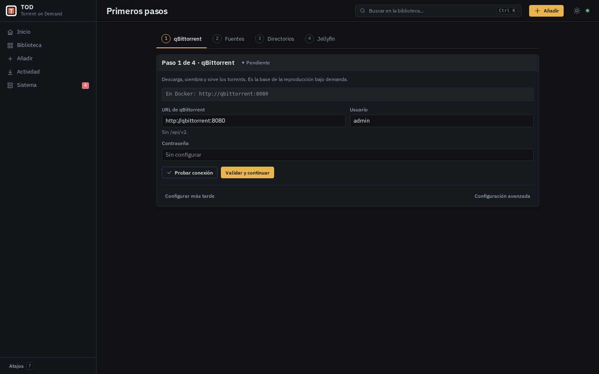

<p align="center">
  <picture>
    <source media="(prefers-color-scheme: dark)" srcset="docs/assets/tod-banner-dark.png">
    
  </picture>
</p>

<p align="center">
  <a href="https://github.com/GitCorion/TOD/actions/workflows/tests.yml"></a>
  <a href="LICENSE"></a>
  <a href="https://www.python.org/"></a>
</p>

TOD unifica catálogo, reproducción y administración en un servicio. Se integra
con qBittorrent, Jellyfin, Prowlarr, Jackett y, opcionalmente, Radarr/Sonarr.
Esos servicios siguen siendo independientes: el `docker-compose.yml` incluido
los levanta juntos para que la instalación sea de un solo comando.

<p align="center">
  
</p>

<p align="center"><sub>TOD está en beta activa. La interfaz y la API pueden cambiar entre versiones menores.</sub></p>

No hace falta editar bases de datos ni archivos de configuración de Prowlarr.
Las URLs y API keys se introducen en la web y TOD aplica el resto. En Docker,
`.env` solo aporta valores iniciales como UID/GID, IP permitida y claves.

## Qué puedes hacer

- **Buscar y añadir** películas y series desde TMDB.
- **Añadir desde una sola caja**: un título, un enlace de TMDB, un ID o una
  lista. Se puede marcar «Añadir a Seguimiento» y el resultado queda registrado.
  También puedes subir un `.torrent` manual a qBittorrent.
- **Crear entradas multiversión en Jellyfin**: un `.strm` principal y una
  variante por versión reproducible.
- **Reproducir bajo demanda** desde qBittorrent con rangos HTTP reales (206).
- **Sembrar con reglas** por tracker: mínimo de horas y ratio con force-start.
  Al cumplirse, TOD lo suelta y, por defecto, qBittorrent decide si borra el torrent. El borrado desde TOD es una opción desactivada.
- **Descubrir fuentes** en Prowlarr, Jackett o ambos, sin listas de trackers escritas a mano.
- **Leer Radarr/Sonarr por API**, nunca tocando sus bases de datos.
- **Seguir por defecto** lo que no está en Radarr/Sonarr. En cuanto TOD crea
  su `.strm`, cierra el seguimiento y deja de buscar.
- **Automatizar** RSS, seguimiento, backfill, puente, restauración y límites de qBittorrent.
- **Ver qué necesita atención** en Inicio, con el motivo y un enlace al ajuste exacto.
- **Configurar integraciones, directorios y tareas** desde
  **Sistema → Configuración**, con pruebas de conexión.

## Cómo funciona

```text
Jellyfin ──.strm──▶ TOD :8773 ──▶ fichero local / archivo
                         │
                         ├──▶ qBittorrent (descarga y seed)
                         ├──▶ Prowlarr    (indexers)
                         ├──▶ Jackett     (indexers)
                         └──▶ Radarr/Sonarr (solo API, biblioteca)
```

Un único proceso sirve:

- la web y su API (`/`, `/api/*`),
- el motor de reproducción (`/play`, `/resolve`, `/sources`, `/status`,
  `/catalog/lookup`, `/prepare`, `/lease`),
- el scheduler interno de tareas periódicas.

## Versiones y `.strm`

Cada película o episodio visible en Jellyfin tiene un `.strm` principal. Películas y
episodios van en rutas distintas:

```text
movies/Título (Año)/Título (Año).strm
series/Título (Año)/Season 01/Título S01E01.strm
```

Si hay **más de una versión reproducible**, se añade una variante por versión:

```text
movies/Título (Año)/Título (Año) - 1080p Cast.strm
movies/Título (Año)/Título (Año) - 4K VO - Tracker.strm
series/Título (Año)/Season 01/Título S01E01 - 1080p Cast.strm
```

- El principal resuelve la mejor fuente disponible al reproducir.
- Cada variante apunta a una versión concreta por su `release_id`, no por una
  ruta fija: si el fichero se mueve y Radarr/Sonarr o qBittorrent actualizan su
  ruta, la variante sigue funcionando sin regenerar el `.strm`. Si esa versión
  desaparece, falla solo esa variante; el `.strm` principal sigue resolviendo
  otra fuente.
- Cada variante apunta a una versión concreta y aparece como versión distinta
  en Jellyfin, para elegir calidad o audio.
- El nombre usa calidad y audio; si se repiten, añade tracker o id.
- Solo se crea la entrada si hay algo que reproducir: **un release vivo con seeds** o
  un fichero local/archivado. Los releases muertos no crean entradas vacías.
- `library_files` se refresca desde Radarr/Sonarr. Si una API falla, TOD
  conserva las rutas que ya conocía en vez de vaciar la biblioteca.
- Radarr/Sonarr se espejan completos al catálogo, pero su `.strm` solo aparece
  cuando TOD encuentra una fuente viva o un fichero local.
- Si la fuente muere, TOD la busca otra vez al reproducir. Si ya no hay
  ninguna, el `.strm` se retira en la reconciliación diaria.

El catálogo y `.strm` son dos niveles distintos. El catálogo puede contener
miles o millones de títulos; Jellyfin solo ve los que tienen una fuente viva
o un fichero local. Al reproducir, TOD revalida la fuente, busca otra si hace
falta y prepara el torrent sin esperar a la cola de Radarr/Sonarr.

## Instalación desde una release

Cada release publica una imagen de Docker, un wheel de Python y un
`docker-compose.release.yml` listo para usar.

- **Docker (recomendado)**: descarga `docker-compose.release.yml` y
  `env.docker.example` de la
  [última release](https://github.com/GitCorion/TOD/releases/latest), renombra
  el segundo a `.env`, ajusta la IP del servidor y las claves, y ejecuta
  `docker compose -f docker-compose.release.yml up -d`.
- **Python 3.11+**: instala el `.whl` de la release y ejecuta
  `tod service --host 0.0.0.0 --port 8773`.
- **Desde el código**: clona el tag y usa la guía de Docker o systemd.

La imagen se publica en `ghcr.io/gitcorion/tod`.

## Instalación con Docker Compose

Es la opción recomendada para una instalación completa: TOD, qBittorrent,
Jellyfin, Prowlarr y Jackett, cada uno en su contenedor y conectados entre sí.

```bash
git clone https://github.com/GitCorion/TOD.git
cd TOD
cp .env.docker.example .env
# edita .env: IP del servidor, UID/GID y claves
docker compose up -d --build
```

Si abres el panel por IP, añade esa IP a `TOD_WEB_ALLOWED_HOSTS` en `.env`. Por
defecto el compose solo permite `localhost` y la red interna.

Servicios y puertos:

| Servicio | URL | Para qué |
|---|---|---|
| TOD | `http://IP_DEL_SERVIDOR:8773` | catálogo, alta y configuración |
| Jellyfin | `http://IP_DEL_SERVIDOR:8096` | reproducir la biblioteca |
| qBittorrent | `http://IP_DEL_SERVIDOR:8080` | descargas y seed |
| Prowlarr | `http://IP_DEL_SERVIDOR:9696` | indexers |
| Jackett | `http://IP_DEL_SERVIDOR:9117` | indexers |

Radarr y Sonarr no están en el compose: si los usas, conéctalos por URL y API
key desde **Configuración → Integraciones**. Prowlarr y Jackett sí están, pero
no es necesario usar los dos: TOD consulta las fuentes que configures.

Primera puesta en marcha:

La primera vez, TOD abre el asistente de **Primeros pasos**: valida
qBittorrent, fuentes y directorios antes de guardar. Si lo cierras, se retoma
desde **Configuración → Primeros pasos**. El resultado de la última prueba se
guarda: si una integración deja de responder, su paso vuelve a marcarse como
pendiente. Si TOD detecta Docker, el asistente propone las URLs internas
(`http://qbittorrent:8080`, `http://prowlarr:9696/api/v1`…) y las rutas
`/media/catalogo` y `/downloads`.

<p align="center">
  
</p>

1. Abre TOD en `8773`.
2. Configura qBittorrent con `http://qbittorrent:8080` y sus credenciales.
3. Configura Prowlarr, Jackett o ambos. La API key de Jellyfin es opcional:
   solo sirve para avisos de escaneo y para detectar la sesión activa.
4. En Jellyfin, añade `/media/catalogo/movies` como **Películas** y
   `/media/catalogo/series` como **Series**.
5. En TOD, revisa **Configuración → Directorios**.

Los detalles de volúmenes, claves y primer arranque están en
[docs/DOCKER.md](docs/DOCKER.md).

## Instalación con systemd

Para instalar sobre un servidor Linux ya existente, sin contenedores:

```bash
git clone https://github.com/GitCorion/TOD.git
cd TOD
sudo bash deploy/install-unified.sh
```

Requiere Python 3.11+. El instalador crea `/etc/tod.env` si no existe, instala
`tod.service`, desactiva servicios antiguos y arranca TOD en `0.0.0.0:8773`.

Después, abre `http://IP_DEL_SERVIDOR:8773`. La primera vez se abre el
asistente de **Primeros pasos**, que valida cada conexión antes de guardar;
si lo cierras, vuelve desde **Configuración → Primeros pasos**.

Configuración manual:

1. **qBittorrent**: URL, usuario y contraseña.
2. **Prowlarr**: URL y API key (opcional si usas Jackett).
3. **Jackett**: URL y API key (opcional si usas Prowlarr).
4. **Jellyfin**: URL y API key.
5. **Directorios**: biblioteca del catálogo, descargas, semillas y biblioteca existente.
6. **Radarr/Sonarr** (opcional): URL y API key. TOD solo usa su API.

Prowlarr y Jackett son alternativas: configura uno o ambos.

Cada integración tiene **Probar** para validar antes de guardar; cada directorio
tiene **Comprobar**. Los secretos se guardan en `var/tod.db` con permisos
`0600` (en Docker, `/config/tod.db`) y nunca se devuelven al navegador.

## Integraciones

| Servicio | Uso en TOD | Necesario |
|---|---|---|
| qBittorrent | Descargar, sembrar y servir torrents | Sí, para reproducir bajo demanda |
| Prowlarr | Descubrir releases y comprobar salud | Uno de los dos |
| Jackett | Descubrir releases | Uno de los dos |
| Jellyfin | Reproducir los `.strm` y avisar de rutas nuevas | Opcional |
| Radarr | Espejo de biblioteca y destino de lo descargado por TOD | Opcional |
| Sonarr | Espejo de biblioteca y destino de lo descargado por TOD | Opcional |
| TMDB | Metadatos, pósters y sinopsis | Recomendado |

TOD se integra con Radarr y Sonarr mediante sus APIs. Solo necesita la URL y
la API key de cada servicio.
Los trackers se descubren de la fuente que configures: Prowlarr (incluido el
idioma de cada indexer) o Jackett (`all`, con el indexer real de cada
resultado). Puedes usar uno o ambos; no hay listas privadas en el repositorio.

## Configuración desde la web

**Sistema → Estado** es diagnóstico: avisos, servicios, tareas, discos y
auditoría, con enlaces a la sección que los arregla.

**Sistema → Configuración** incluye:

- **Integraciones** con prueba de conexión y el motivo concreto de cada fallo.
- **Directorios** con comprobación de existencia, escritura y espacio. Las
  bibliotecas de Radarr (películas) y Sonarr (series) se configuran por separado.
- **Reproducción**: descargas simultáneas, tamaño máximo y URL base de `.strm`.
- **Idioma**: cualquier idioma, castellano primero (V.O. como respaldo) o solo castellano.
  En títulos originalmente españoles manda el país de origen: castellano en
  España y latino en Latinoamérica; el doblaje latino del resto queda fuera.
- **Trackers y siembra**: mínimo de días/ratio, force-start y políticas por
  tracker. Desde aquí se permite o bloquea la descarga de cada tracker y se
  puede borrar, opcionalmente, los `.strm` que dependen de él. El `.strm`
  principal solo se borra si el título se queda sin otra fuente ni fichero local.
- **Seguridad**: token web y hosts permitidos.
- **Tareas programadas**: activar, cambiar cadencia, ver la próxima ejecución y lanzar ahora.

Los valores se guardan en SQLite y mandan sobre `/etc/tod.env`. Los cambios se
aplican en caliente, salvo la URL base de reproducción, que requiere reinicio.
El puerto se fija al arrancar el servicio.

## Seguridad

- Pensado para LAN o WireGuard. No publiques el puerto en Internet.
- `/prepare` y `/lease` solo aceptan peticiones desde loopback.
- `download=1` en `/play` inicia una descarga explícita. Las rutas de
  reproducción no usan el token del panel: restringe el puerto a LAN/WireGuard.
- Los secretos viven en `var/tod.db` (`0600`, en Docker `/config/tod.db`);
  `.env` y `var/` están ignorados por git.
- Lee [SECURITY.md](SECURITY.md) antes de exponer el servicio.

## Desarrollo

```bash
python3 -m venv .venv
. .venv/bin/activate
pip install -e ".[dev]"
ruff check .
python -m pytest -q
```

También se puede instalar como paquete:

```bash
pip install .
tod service --host 0.0.0.0 --port 8773
```

En una instalación de paquete, la base va a
`~/.local/share/tod/tod.db` y las migraciones viajan dentro del paquete. En un
clon se sigue usando `var/tod.db`. Docker Compose y el instalador systemd son
la opción recomendada para un servidor completo.

## Documentación

- [Docker Compose](docs/DOCKER.md)
- [Arquitectura](docs/ARCHITECTURE.md)
- [Diseño de la interfaz](DESIGN.md)
- [Operación y mantenimiento](docs/OPERATIONS.md)
- [Integraciones paso a paso](docs/INTEGRATIONS.md)
- [Glosario de la interfaz](docs/GLOSARIO.md)
- [Cómo contribuir](CONTRIBUTING.md)
- [Seguridad](SECURITY.md)

## Licencia

MIT. Consulta [LICENSE](LICENSE).
