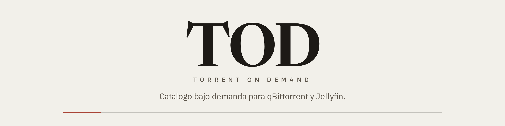
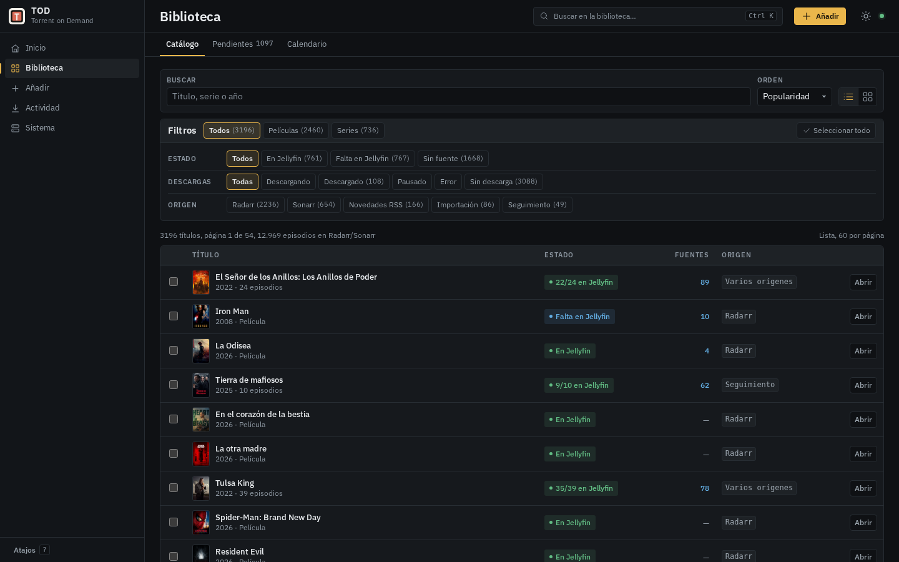

<p align="center">
  <picture>
    <source media="(prefers-color-scheme: dark)" srcset="docs/assets/tod-banner-dark.png">
    
  </picture>
</p>

<p align="center">
  <a href="https://github.com/GitCorion/TOD/actions/workflows/tests.yml"></a>
  <a href="LICENSE"></a>
  <a href="https://www.python.org/"></a>
</p>

**TOD (Torrent on Demand)** es un servicio unificado de biblioteca, gestión de
releases y streaming bajo demanda para **Jellyfin** y **qBittorrent**, con
soporte para **Prowlarr**, **Jackett**, **TMDB** y sincronización vía API con
**Radarr** y **Sonarr**.

<p align="center">
  
</p>

<p align="center"><sub>Estado: beta activa. La interfaz y la API pueden cambiar entre versiones menores.</sub></p>

## Características principales

- **Biblioteca y alta unificada**: gestión de películas, series y sagas desde
  TMDB con búsqueda por texto, enlaces, IDs, listas por lotes o ficheros
  `.torrent`. Incluye editor masivo, etiquetas y vistas en carteles o tabla.
- **Perfiles de calidad, Custom Formats y restricciones**: puntuación
  configurable de releases, calidad objetivo (*cutoff*), bloqueo de formatos
  (CAM, ISO/BDMV) y reglas de idioma (cualquier idioma, castellano primero o
  solo castellano).
- **Búsqueda automática e interactiva**: selección manual por título o
  temporada completa (incluidos packs), fijación de release por defecto,
  descarga forzada y gestión de **Blocklist**.
- **Buscados y Calendario**: seguimiento de *Faltantes*, *Mejorables* (por
  debajo de la calidad objetivo) y *Próximos* estrenos, además de listas de
  importación programadas desde TMDB o URLs JSON.
- **`.strm` multiversión y `.nfo`**: generación automática de un `.strm`
  principal y variantes por calidad/audio/tracker para Jellyfin, con plantillas
  de nombrado configurables.
- **Streaming bajo demanda**: reproducción directa desde qBittorrent mediante
  rangos HTTP (`206`) sin necesidad de completar la descarga previamente.
- **Políticas de siembra por tracker**: retención con `force-start` hasta
  cumplir días y ratio mínimos antes de delegar la gestión a qBittorrent.
- **Integración con Radarr y Sonarr**: espejo de biblioteca, respaldo de
  títulos sin fichero y puente de importación a través de sus APIs oficiales.
- **Diagnóstico integrado**: panel **Inicio** y **Sistema → Estado** con
  supervisión de servicios, discos, indexers, tareas programadas y avisos.

## Arquitectura

```text
Jellyfin ──.strm──▶ TOD :8773 ──▶ fichero local / nube (archivo)
                         │
                         ├──▶ qBittorrent (cola, descarga y siembra)
                         ├──▶ Prowlarr    (indexers y salud)
                         ├──▶ Jackett     (indexers)
                         └──▶ Radarr/Sonarr (API)
```

Un único proceso sirve la interfaz web y la API (`/api/*`), el motor de
reproducción (`/play`, `/resolve`, `/sources`, `/status`, `/catalog/lookup`,
`/prepare`, `/lease`) y el planificador de tareas periódicas.

### Ecosistema Medusa

| Componente | Función |
|---|---|
| [Medusa](https://github.com/GitCorion/Medusa) | Cliente nativo para Android TV y tablet que reproduce desde Jellyfin. |
| [Medusa-Jellyfin-Plugin](https://github.com/GitCorion/Medusa-Jellyfin-Plugin) | Plugin de Jellyfin que expone `/Medusa/Capabilities`, `/Status`, `/Prepare` y `/Lease` para preparación bajo demanda y negociación de versiones. |
| **TOD** | Servidor de biblioteca, selección de releases, `.strm` y streaming por rangos. |

## Funcionamiento de `.strm` y versiones

Cada película o episodio disponible en Jellyfin genera un `.strm` principal:

```text
movies/Título (Año)/Título (Año).strm
series/Título (Año)/Season 01/Título S01E01.strm
```

Cuando existen múltiples releases reproducibles, TOD genera variantes
adicionales para seleccionar calidad o idioma desde Jellyfin:

```text
movies/Título (Año)/Título (Año) - 1080p Cast.strm
movies/Título (Año)/Título (Año) - 4K VO - Tracker.strm
series/Título (Año)/Season 01/Título S01E01 - 1080p Cast.strm
```

- El `.strm` principal resuelve dinámicamente el mejor release disponible al
  iniciar la reproducción.
- Las variantes apuntan de forma estable al identificador interno del release,
  manteniendo la validez aunque cambie la ruta del fichero en disco.
- Solo se generan `.strm` para títulos con un release vivo (con seeds) o un
  fichero local/en nube; la reconciliación diaria retira accesos obsoletos.

## Instalación

### Desde una release

Cada publicación incluye imagen Docker en `ghcr.io/gitcorion/tod`, paquete
Python (`.whl`) y `docker-compose.release.yml`:

- **Docker**: descarga `docker-compose.release.yml` y `env.docker.example` desde
  la [última release](https://github.com/GitCorion/TOD/releases/latest),
  renombra el segundo a `.env`, ajusta `TOD_WEB_ALLOWED_HOSTS` y las claves, y
  ejecuta `docker compose -f docker-compose.release.yml up -d`.
- **Python 3.11+**: instala el `.whl` y arranca con
  `tod service --host 0.0.0.0 --port 8773`.

### Con Docker Compose (desde código)

Despliega TOD junto con qBittorrent, Jellyfin, Prowlarr y Jackett:

```bash
git clone https://github.com/GitCorion/TOD.git
cd TOD
cp .env.docker.example .env
# Ajusta TOD_WEB_ALLOWED_HOSTS, PUID/PGID y claves en .env
docker compose up -d --build
```

| Servicio | Puerto | Función |
|---|---|---|
| TOD | `8773` | Interfaz web, API y streaming |
| Jellyfin | `8096` | Servidor multimedia |
| qBittorrent | `8080` | Cliente BitTorrent |
| Prowlarr | `9696` | Gestor de indexers |
| Jackett | `9117` | Gestor de indexers alternativo |

Consulta [docs/DOCKER.md](docs/DOCKER.md) para detalles sobre volúmenes y
variables de entorno.

### Con systemd (Linux)

```bash
git clone https://github.com/GitCorion/TOD.git
cd TOD
sudo bash deploy/install-unified.sh
```

Requiere Python 3.11+. Genera `/etc/tod.env`, registra `tod.service` y expone
el panel en `0.0.0.0:8773`.

## Configuración inicial

Al acceder por primera vez a `:8773`, el asistente de **Primeros pasos**
valida las conexiones y rutas antes de guardarlas:

<p align="center">
  
</p>

1. Configura **qBittorrent**, **Prowlarr** o **Jackett**, y las **rutas** de
   almacenamiento.
2. En **Jellyfin**, añade `/media/catalogo/movies` (**Películas**) y
   `/media/catalogo/series` (**Series**).
3. Si utilizas **Radarr** o **Sonarr**, añade su URL y API key en
   **Sistema → Configuración → Integraciones e Indexers**.

## Integraciones

| Servicio | Función | Requisito |
|---|---|---|
| qBittorrent | Descarga, siembra y lectura de piezas para streaming | Obligatorio para reproducción bajo demanda |
| Prowlarr | Búsqueda de releases y comprobación de salud | Obligatorio (Prowlarr o Jackett) |
| Jackett | Búsqueda de releases | Alternativa o complemento a Prowlarr |
| Jellyfin | Reproducción de `.strm` y refresco de bibliotecas | Opcional |
| Radarr | Espejo de películas y destino tras descarga | Opcional |
| Sonarr | Espejo de series y destino tras descarga | Opcional |
| TMDB | Metadatos, pósters, sinopsis y sagas | Recomendado |

## Configuración desde la web

La configuración reside en SQLite (`var/tod.db`, o `/config/tod.db` en Docker)
con precedencia sobre las variables de entorno, dividida en siete secciones bajo
**Sistema → Configuración**:

- **General y Rutas**: directorios (`.strm`, Radarr/Sonarr, descargas y
  archivo), límites de reproducción, preferencia de idioma y seguridad.
- **Integraciones e Indexers**: credenciales con prueba de conexión y control de
  indexers de Prowlarr.
- **Perfiles y Custom Formats**: perfiles de calidad, *cutoff*, reglas de
  puntuación y restricciones de texto.
- **Gestión de medios (`.strm`)**: carpetas raíz, plantillas de nombrado para
  `.strm` y `.nfo`, separación de anime y vista previa de renombrado.
- **Etiquetas y Listas**: etiquetas y listas de importación automática (TMDB o
  JSON).
- **Trackers y Siembra**: políticas mínimas de días/ratio, `force-start`,
  retención hasta biblioteca y bloqueo por tracker.
- **Tareas programadas**: cadencias, activación y ejecución manual.

## Seguridad

TOD está pensado para ejecutarse en LAN o tras WireGuard (**no exponer el puerto
`8773` a Internet**). Las rutas de reproducción no requieren token web y los
secretos se guardan en `var/tod.db` (`0600`). Consulta [SECURITY.md](SECURITY.md).

## Desarrollo

```bash
python3 -m venv .venv
. .venv/bin/activate
pip install -e ".[dev]"
ruff check .
python -m pytest -q
```

Para instalar como paquete del sistema (`pip install .` y
`tod service --host 0.0.0.0 --port 8773`), la base de datos se ubica en
`~/.local/share/tod/tod.db`.

## Documentación

- [Docker Compose](docs/DOCKER.md)
- [Arquitectura](docs/ARCHITECTURE.md)
- [Diseño de la interfaz](DESIGN.md)
- [Operación y mantenimiento](docs/OPERATIONS.md)
- [Integraciones paso a paso](docs/INTEGRATIONS.md)
- [Glosario de la interfaz](docs/GLOSARIO.md)
- [Cómo contribuir](CONTRIBUTING.md)
- [Seguridad](SECURITY.md)

## Licencia

MIT. Consulta [LICENSE](LICENSE).
